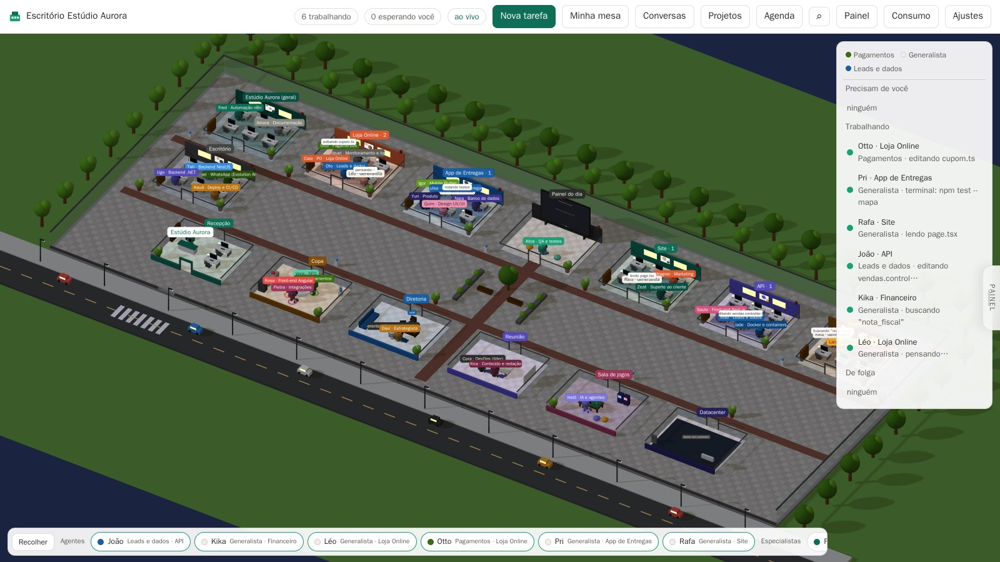
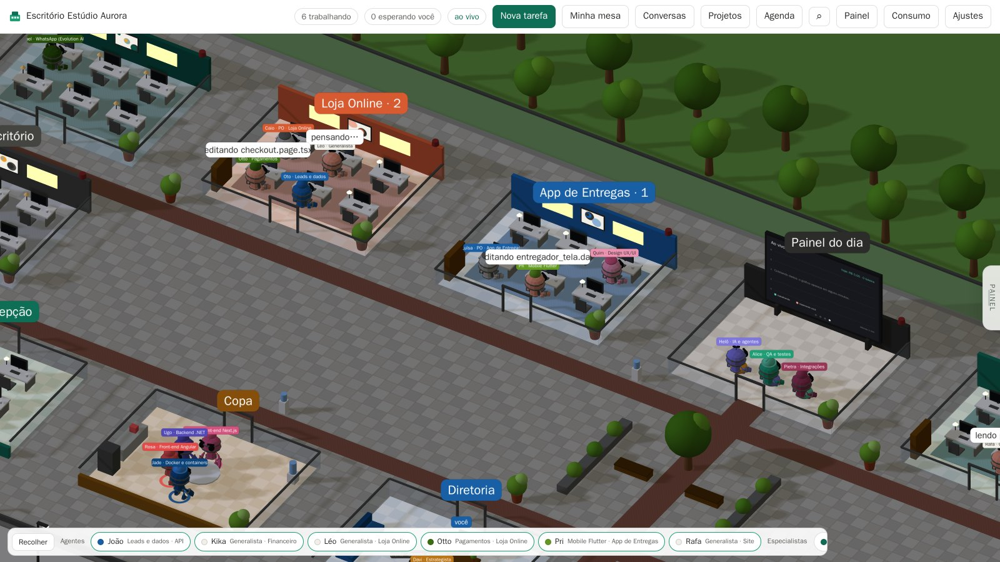
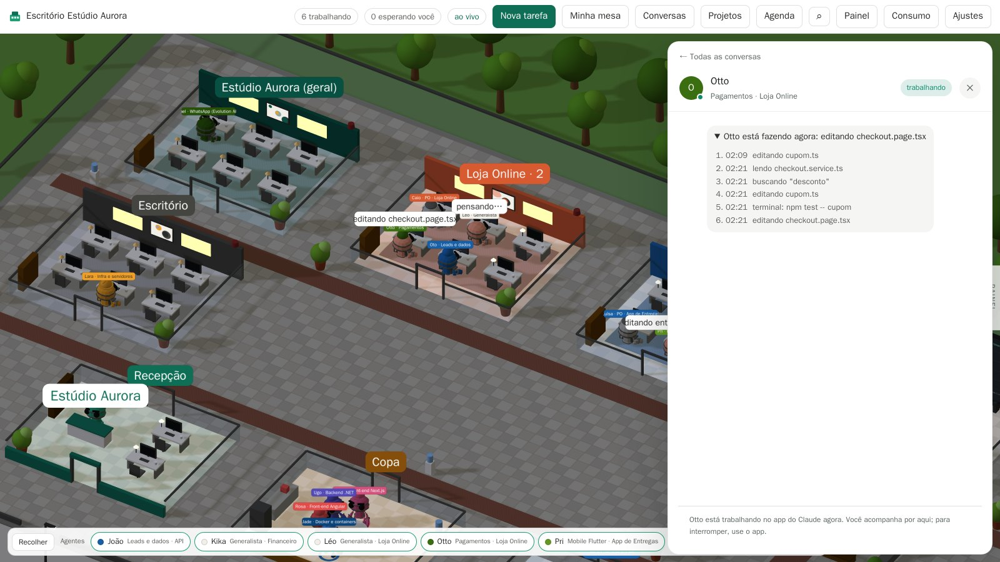
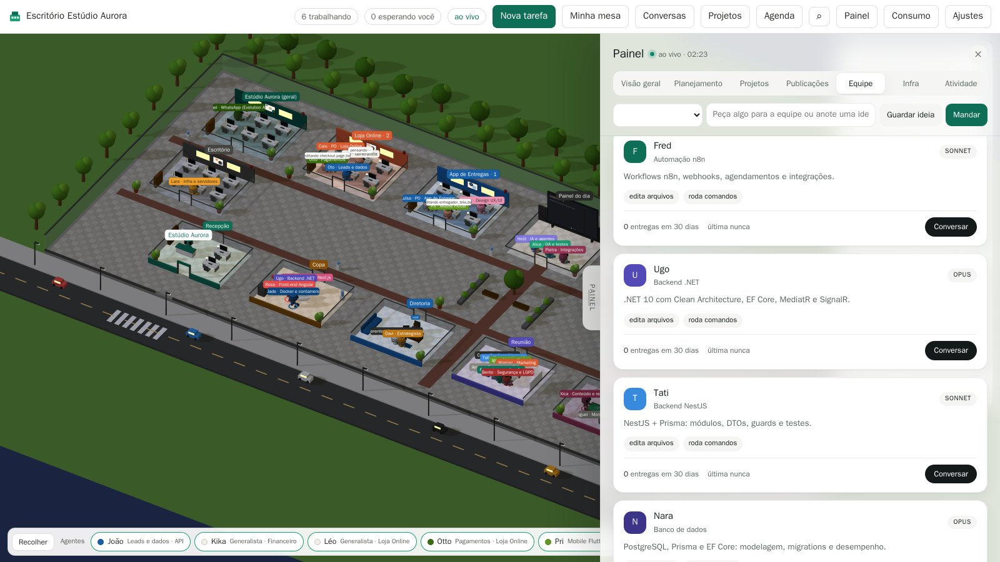
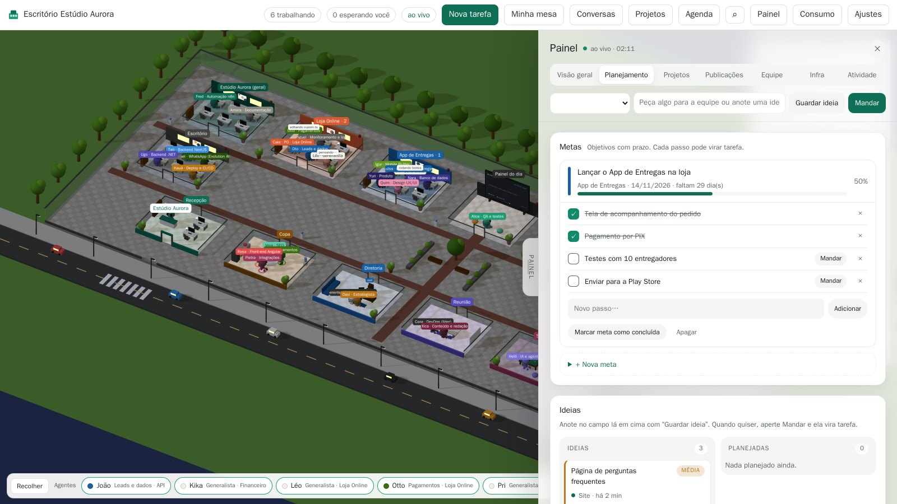

# Como instalar e usar o Escritório de Agentes

Este guia vai do zero até você mandar a primeira tarefa para um agente. Leva uns 10 minutos.



## 1. Antes de começar

Você vai precisar de:

| O quê | Para quê | Como conferir |
| --- | --- | --- |
| Linux com systemd (VPS, servidor ou PC) | rodar as tarefas dos agentes | `systemctl --version` |
| Node.js 20 ou mais novo | rodar o escritório | `node -v` |
| Claude Code logado com a sua assinatura (Pro ou Max) | os agentes | `claude` abre e responde |
| `curl`, `jq` e `git` | ganchos e instalação | `jq --version` |

> Em Mac ou Windows o escritório abre e mostra os agentes que você usa no terminal, mas mandar tarefas
> **pelo** escritório só funciona em Linux.

Se o Claude Code ainda não estiver logado, rode `claude` no terminal e siga o login pela assinatura
(não use chave de API: o escritório foi feito para a assinatura).

## 2. Instalar

```bash
git clone https://github.com/Rodrigossff91/escritorio-de-agentes.git
cd escritorio-de-agentes
./instalar.sh
```

O instalador pergunta:

1. **Nome da empresa** (ou o seu nome, ou "Meus estudos").
2. **Pasta dos projetos**, por exemplo `/home/voce/projetos`. Cada subpasta vira uma sala do escritório.
3. **Quais projetos entram** (ou `todos`).
4. **Latitude e longitude da sua cidade** (opcional: chove no escritório quando chove aí).
5. **Usuário e senha** para entrar no escritório.
6. Se pode **ligar o escritório ao Claude Code** (ele faz backup do seu `settings.json` antes).
7. Se roda como root: se quer instalar como **serviço** (liga sozinho com a máquina).

Se não instalou como serviço, ligue com:

```bash
node server.mjs
```

Abra **http://127.0.0.1:4800** e entre com o usuário e a senha que você criou.

### Conte aos agentes sobre os seus projetos

Abra `especialistas/_empresa.md` e descreva cada projeto em uma linha: a pasta, o que é e a stack.
Quanto melhor descrito, melhor os agentes trabalham. Esse arquivo é seu e não vai para o git.

## 3. Ver os agentes trabalhando

Abra o Claude Code em qualquer pasta de projeto, como sempre faz. No escritório:

- um **robô** entra pela recepção e senta na mesa da sala do projeto;
- o **balão** em cima da cabeça mostra o que ele está fazendo ("editando cupom.ts", "rodando testes");
- quando ele precisa de você, vai até a **Diretoria** com um "!" e a barra de cima avisa "esperando você";
- quando termina, a entrega chega nas **Conversas**.



Arraste para girar a câmera, arraste com o botão direito (ou segurando Shift) para andar, e use a roda do mouse para aproximar. Clicar numa sala abre uma tarefa nova para aquele projeto.

## 4. Conversar com um agente

Clique em qualquer robô: o chat dele abre do lado. Você vê **o que ele está fazendo agora**, passo a passo,
e as entregas anteriores, cada uma com resumo, resultado e próximos passos.



Para responder ou pedir mais, escreva embaixo e escolha:

- **Conversar**: ele só lê e responde, sem mexer em nada.
- **Executar**: ele vai até o projeto e faz.

O botão **Conversas** (lá em cima) junta todas as conversas, com filtros "Esperando você" e "Não lidas",
e o **+ Nova conversa** para chamar um especialista específico.

## 5. Mandar uma tarefa

Três jeitos:

1. **Nova tarefa** (botão verde): escolha o projeto, escreva o pedido e mande. O escritório escolhe o especialista.
2. **Painel** (tecla **P**): escreva no campo do topo e aperte **Mandar**, ou **Guardar ideia** para depois.
3. **Busca geral** (**Ctrl+K**): escreva `devops ver o certificado do site` e aperte Enter para mandar direto para o DevOps.

As tarefas rodam com a sua assinatura do Claude, no máximo 4 ao mesmo tempo (o resto espera na fila).

## 6. A equipe de especialistas

Cada especialista tem um manual próprio (em `especialistas/`), um modelo (Sonnet, Opus ou Haiku) e permissões
(se pode editar arquivos e rodar comandos). No **Painel → Equipe** você vê quem faz o quê e conversa com cada um.



- **QA** revisa as entregas antes de chegarem a você (e devolve para corrigir quando acha problema).
- **DevOps** faz a ronda diária da produção e publica quando você manda.
- **PO** de cada produto refina os pedidos e faz o resumo semanal (ligue com `"po": true` no projeto, no `config.json`).
- **Estrategista** escreve um memorando por mês sobre a empresa.
- Quando você pede para refazer algo, a equipe aprende: uma vez por semana eles propõem melhorias nos próprios
  manuais, e você aprova em **Ajustes → Melhorias da equipe**.

### Reunião

No **Painel → Equipe → Reunião**, descreva um problema e escolha 2 ou 3 especialistas. Eles vão para a sala de
reunião, dão a sua visão, discutem entre si e o gerente fecha uma decisão. As tarefas que saem da reunião viram
ideias planejadas, prontas para mandar. Na reunião eles só leem o projeto: não mexem em nada.

## 7. Painel: planejamento e acompanhamento

Puxe a aba **PAINEL** na borda direita (ou aperte **P**).



| Aba | O que tem |
| --- | --- |
| Visão geral | números do dia, entregas por dia, agentes trabalhando e projetos mais ativos |
| Planejamento | **metas** com prazo e passos, **ideias** para depois, quadro do trabalho e próximos 7 dias |
| Projetos | ficha de cada projeto: saúde, quem está trabalhando, últimas entregas |
| Publicações | histórico do que foi ao ar, com pedido de volta de versão |
| Equipe | especialistas e reuniões |
| Infra | memória, disco e swap do servidor, containers e rotinas |
| Atividade | linha do tempo das últimas 48 horas |

Num passo de meta, aperte **Mandar**: ele vira tarefa e é marcado como feito sozinho quando a equipe entrega.

## 8. Publicar em produção com segurança

Os agentes **não conseguem** publicar sozinhos: um gancho bloqueia `git push`, deploy e afins nas tarefas do escritório.

1. O agente termina e registra o pedido com `escritorio-publicar` (o que vai ao ar e como verificar).
2. Aparece um cartão **Pronto para publicar** na conversa e na barra de cima.
3. Você aperta **Publicar**. O DevOps confere estado, migrations e backup, publica e verifica no ar.

Mudou alguma tela? O agente pode subir uma **prévia** (`escritorio-previa`) com um link para você ver antes.

## 9. Convidar um amigo para um projeto

Em **Ajustes → Convidados**, escolha o nome do amigo, **um** projeto, por quanto tempo vale o acesso e o que ele pode fazer:

| Permissão | O que acontece |
| --- | --- |
| Só ver | ele acompanha os agentes daquele projeto, sem mandar nada |
| Pede e eu aprovo | os pedidos dele chegam para você (barra de cima e Ajustes → Convidados) e só rodam depois que você aprova |
| Manda direto | as tarefas dele rodam na hora |

Aperte **Gerar link** e mande para ele. Dá para trocar a permissão, renovar, gerar outro link ou **cancelar** a qualquer
momento (o link para de funcionar na hora).

O que o convidado vê: uma página só dele, com os agentes daquele projeto e as conversas que **ele** começou.
As tarefas de convidado rodam **trancadas na pasta do projeto**: outros projetos, as conversas do escritório, senhas,
chaves SSH, backups, o histórico do Claude e o Docker ficam invisíveis, e publicar em produção continua bloqueado.

Fique atento a três coisas:
- as tarefas dele usam a **sua** assinatura do Claude;
- o agente dele precisa ler o login do Claude para funcionar, então dê "Manda direto" só para quem você confia;
- os nomes das pastas dos outros projetos aparecem (vazias), mas o conteúdo não.

Para ele abrir o link, ele precisa alcançar o escritório: compartilhe a máquina com ele no Tailscale
(painel do Tailscale → Machines → a máquina → Share).

## 10. Rotinas automáticas

Configure horários em `rotinas` no `config.json`:

| Rotina | Padrão | O que faz |
| --- | --- | --- |
| Ronda da produção | todo dia 07:00 | DevOps olha containers, disco, memória, backups e certificados (só olha) |
| Resumo da manhã | todo dia 08:00 | ontem, o que espera você, saúde e plano do dia |
| Vigia | a cada 5 min | se um container de produção cair, abre um incidente e o DevOps investiga |
| Memorando estratégico | dia 1 de cada mês | análise da empresa pelo Estrategista |
| Melhorias da equipe | toda sexta | especialistas propõem ajustes nos manuais |

## 11. Abrir pelo celular

O escritório só escuta na própria máquina, de propósito. Para abrir de fora com segurança, instale o
[Tailscale](https://tailscale.com) no servidor e no celular e rode:

```bash
tailscale serve --bg --https=8443 http://127.0.0.1:4800
```

Depois coloque o endereço que aparecer (ex.: `minha-maquina.seu-tailnet.ts.net:8443`) em `origensPermitidas`
no `config.json` e reinicie o escritório.

## Problemas comuns

| Sintoma | O que fazer |
| --- | --- |
| Os robôs não aparecem | rode `node scripts/hooks.mjs instalar` e abra uma sessão nova do Claude Code |
| "Conta não está logada pela assinatura" | rode `claude` no terminal e faça o login de novo |
| Tarefa fica parada na fila | confira se há 4 tarefas rodando (é o limite) ou veja os registros com `journalctl -u escritorio-agentes -n 50` |
| Esqueci a senha | `node scripts/definir-senha.mjs` |
| Quero desligar os ganchos | `node scripts/hooks.mjs remover` |
